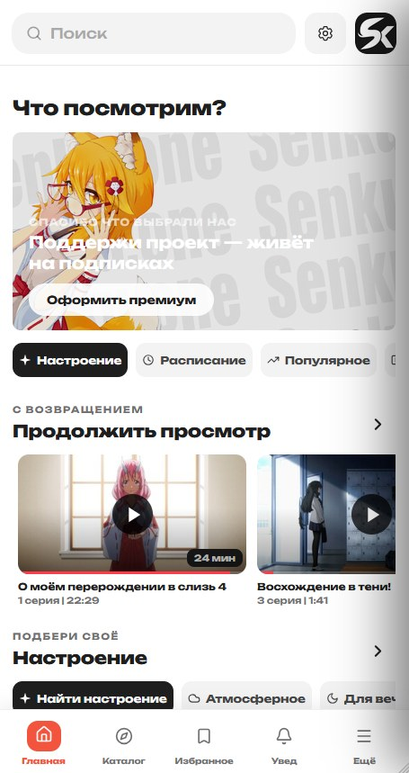
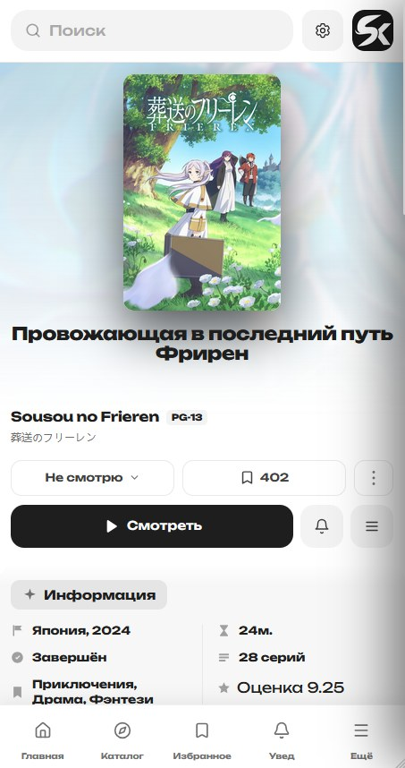
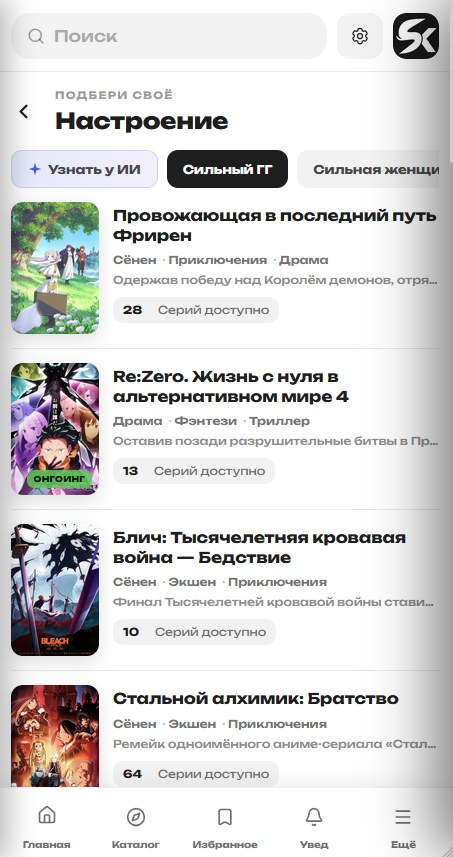
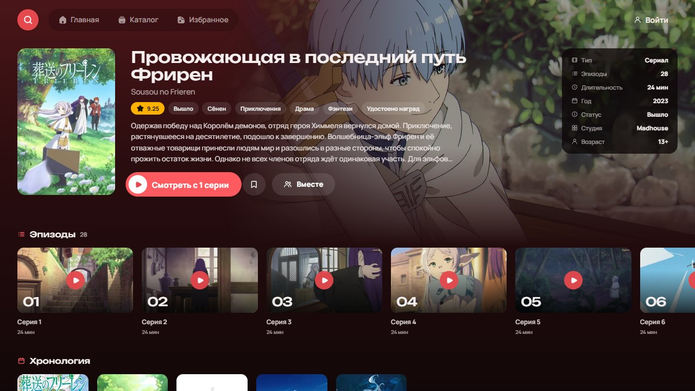
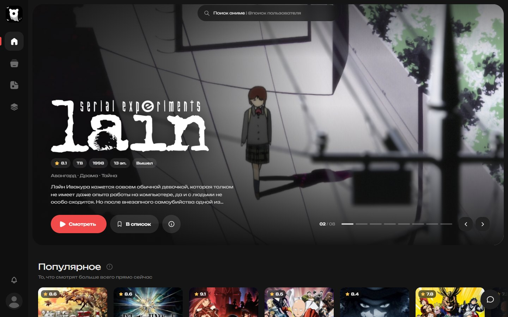
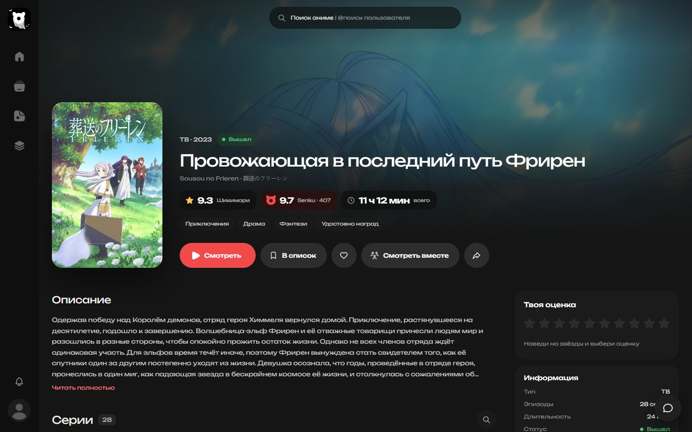

# Все приложения Senku

**Смотри аниме где удобно: на телефоне, телевизоре, компьютере и в браузере.** 
Один аккаунт на всех устройствах: избранное, история, достижения и монеты везде одни и те же.

---

## Скачать

<table>
  <tr>
    <th width="25%">📱 Android</th>
    <th width="25%">📺 Android TV</th>
    <th width="25%">💻 Windows</th>
    <th width="25%">🌐 Сайт</th>
  </tr>
  <tr>
    <td align="center">Телефоны и планшеты Android 7.0 и новее</td>
    <td align="center">Телевизоры и приставки Android TV, Google TV</td>
    <td align="center">Компьютеры и ноутбуки Windows 10 и 11, 64-бит</td>
    <td align="center">Любой браузер ПК, телефон, планшет</td>
  </tr>
  <tr>
    <td align="center"></td>
    <td align="center"></td>
    <td align="center"></td>
    <td align="center"></td>
  </tr>
  <tr>
    <td align="center">версия 1.2.6</td>
    <td align="center">версия 0.5.1</td>
    <td align="center">версия 0.2.33</td>
    <td align="center">всегда свежий</td>
  </tr>
</table>

> Все файлы раздаются только с **senku.one** и подписаны нашим ключом. Не качайте Senku с других сайтов. 
> Все ссылки и инструкции также есть на странице **[senku.one/download](https://senku.one/download)**.

---

## 📱 Android

  
  &nbsp;
  
  &nbsp;
  

- **Серии офлайн.** Скачай заранее и смотри в метро или в самолёте
- **Уведомления о новых сериях** из твоего списка
- **Жесты в плеере** и полноэкранный режим
- **Подборки по настроению,** расписание выхода серий, популярное
- **Обновляется само:** приложение предложит новую версию при запуске

<b>Как установить</b>

1. Скачай файл **Senku-Anime.apk** по кнопке выше
2. Если телефон спросит, разреши установку из этого источника (для браузера, через который скачал файл)
3. Открой файл и нажми **«Установить»**
4. Войди в свой аккаунт Senku или зарегистрируйся

---

## 📺 Android TV

  

- **Сделано под пульт.** Всё листается стрелками, без мыши и клавиатуры
- **Голосовой поиск** через микрофон пульта
- **Плеер под пульт:** стрелка вверх открывает крупные настройки (озвучка, качество, скорость, автопропуск), стрелка вниз открывает серии, кнопка OK пропускает опенинг и эндинг
- **Отметки просмотренного:** сразу видно, какие серии уже посмотрены и где ты остановился
- **Продолжить просмотр** с того места, где остановился на телефоне или компьютере
- **Обновляется само:** когда выходит новая версия, приложение предложит её скачать и установить

<b>Как установить на телевизор</b>

**Способ 1. Через браузер на телевизоре**
1. Открой на телевизоре браузер и зайди на **senku.one/download**
2. Нажми **«Скачать для Android TV»**
3. Разреши установку из неизвестных источников, если телевизор спросит
4. Открой скачанный файл и установи

**Способ 2. Через флешку**
1. Скачай **SenkuTv-0.5.1.apk** на компьютер
2. Скинь файл на флешку и вставь её в телевизор или приставку
3. Открой файл через любой файловый менеджер (например, «Файлы» или X-plore) и установи

**Способ 3. Через Downloader**
1. Установи приложение **Downloader** из Google Play на телевизоре
2. Введи адрес `senku.one/downloads/SenkuTv-0.5.1.apk`
3. После скачивания нажми **«Установить»**

---

## 💻 Windows

  

- **Своё окно без браузера:** не теряется среди вкладок и запускается за секунду
- **Статус в Discord:** друзья видят, что ты смотришь
- **Уведомления в углу экрана** о новых сериях
- **Обновляется само:** новые версии ставятся без лишних действий

<b>Как установить</b>

1. Скачай установщик **Senku-Setup.exe** по кнопке выше
2. Открой файл и следуй подсказкам, это займёт полминуты
3. Если Windows покажет синее окно SmartScreen, нажми **«Подробнее»**, затем **«Выполнить в любом случае»**. Это обычное предупреждение для новых программ

---

## 🌐 Сайт

  

Всё то же самое прямо в браузере на **[senku.one](https://senku.one)**, без установки.

- **Совместный просмотр:** создай комнату, скинь ссылку друзьям, и пауза с перемоткой будут общими у всех, плюс чат
- **Манга:** читалка прямо на сайте
- **Коллекционные карточки** за досмотренные сезоны, достижения, уровни и монеты
- **Профиль:** рамки, теги, витрина карточек, стена с комментариями
- **Подборки и рецензии** от других зрителей

---

## 🐞 Нашли ошибку или есть идея?

Мы читаем все сообщения. Чтобы мы быстро разобрались, выбери подходящую форму:

<table>
  <tr>
    <td align="center" width="33%"><a href="https://github.com/Ra9ge/application.senku.all/issues/new?template=bug_report.yml"><b>🐞 Сообщить об ошибке</b></a> что-то не работает, вылетает, не грузится</td>
    <td align="center" width="33%"><a href="https://github.com/Ra9ge/application.senku.all/issues/new?template=video_problem.yml"><b>🎬 Проблема с видео</b></a> серия не играет, нет озвучки, не та серия</td>
    <td align="center" width="33%"><a href="https://github.com/Ra9ge/application.senku.all/issues/new?template=feature_request.yml"><b>💡 Предложить идею</b></a> чего не хватает в приложении или на сайте</td>
  </tr>
</table>

**Перед тем как написать:**
1. Проверь, что у тебя последняя версия приложения
2. Поищи в [списке Issues](https://github.com/Ra9ge/application.senku.all/issues?q=is%3Aissue), возможно, о проблеме уже написали. Тогда просто поставь 👍
3. Приложи скриншот или видео, если можешь, так мы найдём проблему намного быстрее

> Чтобы писать в Issues, нужен аккаунт GitHub (бесплатно). Если его нет, напиши нам в [Telegram](https://t.me/Senkuone).

---

## ❓ Частые вопросы

<b>Это бесплатно?</b>

Да. Все приложения бесплатные. Подписка Senku Plus работает в них так же, как на сайте.

<b>Сохранится мой аккаунт?</b>

Да. Входишь тем же аккаунтом, и избранное, история, достижения и монеты будут на месте на любом устройстве.

<b>Можно смотреть без интернета?</b>

Да, на Android. Скачай серии заранее в разделе «Загрузки», они откроются без сети.

<b>Как обновить приложение?</b>

Android и Windows проверяют обновления сами при запуске. С версии 0.4.0 Android TV тоже обновляется само. Если у тебя версия старше, один раз скачай новый APK со страницы [senku.one/download](https://senku.one/download) и установи поверх старого, всё сохранится.

<b>Телефон или телевизор не даёт установить APK</b>

Разреши установку из неизвестных источников для приложения, через которое скачал файл (браузер, файловый менеджер или Downloader). Устройство само предложит это сделать.

<b>Есть версия для iPhone?</b>

Пока нет. Открой [senku.one](https://senku.one) в Safari, нажми «Поделиться», затем «На экран Домой», и сайт будет открываться как приложение.

---

**[senku.one](https://senku.one)** · **[Telegram](https://t.me/Senkuone)** · **[Скачать](https://senku.one/download)** · **[Issues](https://github.com/Ra9ge/application.senku.all/issues)**

Этот репозиторий для обратной связи и ссылок на приложения. Исходного кода здесь нет.

